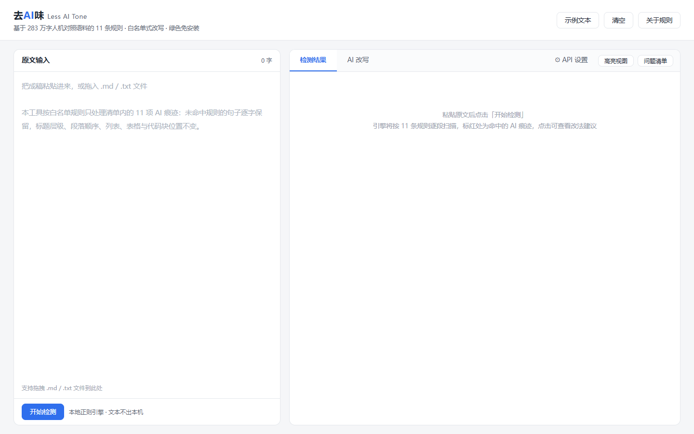
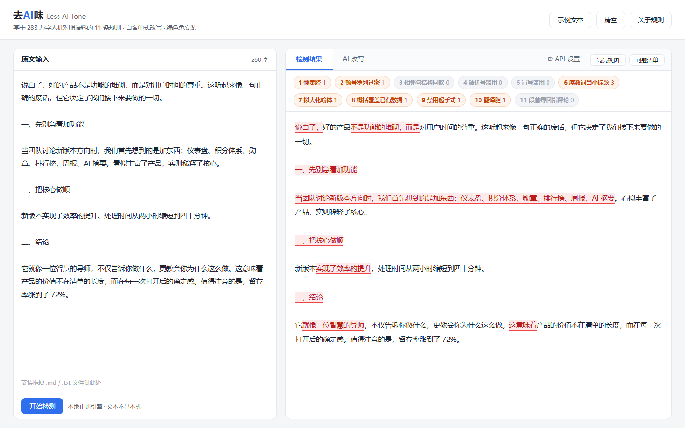
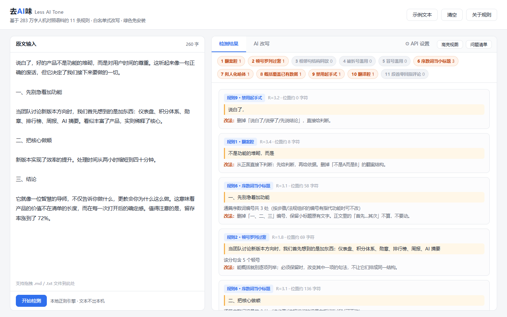
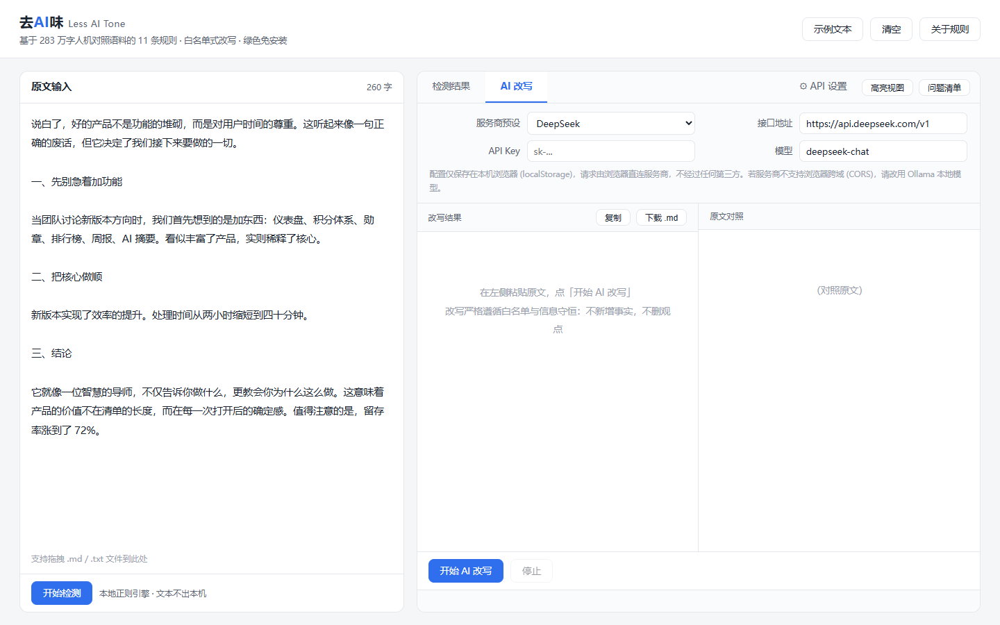
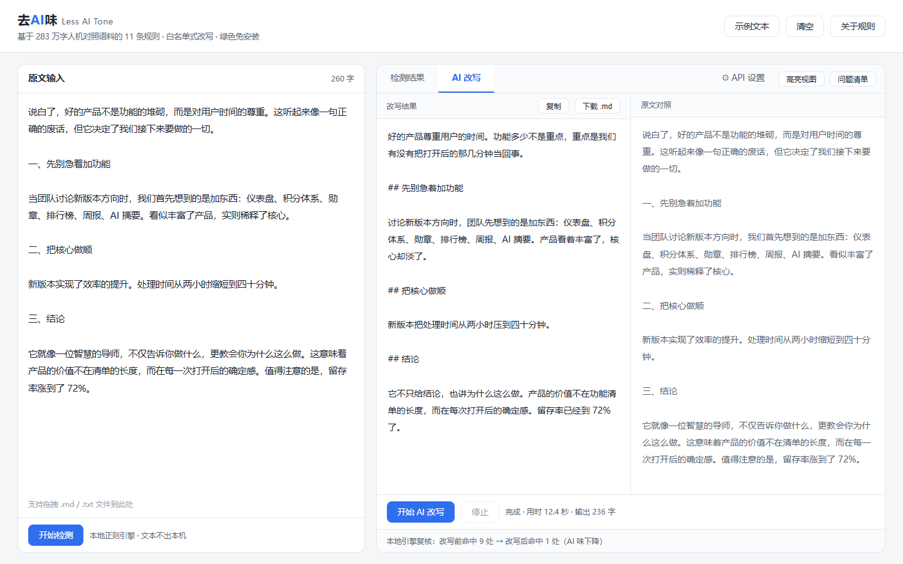

# 去AI味 · Less AI Tone

一个网页版的 AI 写作痕迹检测与改写工具。规则来自 [lieflat-less-ai-tone](https://github.com/larashero3-dotcom/lieflat-less-ai-tone)：以 629 篇文章、282 万字、95,551 句做人机对照统计，检验 26 项候选"AI 文风"特征，最终只有 11 项通过检验。

单文件、无依赖、免安装。检测全程在本地运行，文本不上传。AI 改写走你自己的 API Key，浏览器直连服务商。



## 它解决的问题

网上流传的"AI 文风清单"从未被系统检验。实测结果是：11 项成立，15 项是误会，其中 3 项方向相反——人类用比喻的频率是 AI 的 2.4 倍，正文设问是 17 倍。按流行建议"删掉设问"，文章反而更像机器写的。

所以这个工具的核心不是"帮你改得好看"，而是**只处理有统计依据的 11 项，其余一律不动**。

## 两种模式

### 一、本地检测

粘贴或拖入 `.md` / `.txt`，按 11 条规则的触发标记逐段扫描，命中的片段标红，点击查看规则编号、实测倍率 R 与改法建议。



每处命中生成一张卡片：规则编号、R 值（生成侧与人类侧的频率比）、字符位置、原文引文、可执行改法。



顶部统计标签里，**灰色 0 命中是有用信息**——那几项在这篇里没问题，不必硬改。

### 二、AI 改写

配置任意 OpenAI 兼容服务，把完整规则集注入系统提示词，由大模型逐句执行。改写结果与原文双栏对照，改完自动用本地引擎复核命中数变化。





## 快速开始

无需安装、无需注册、无需 Node 或 Python：

```bash
git clone https://github.com/wyfirstname/less-ai-tone-ui.git
cd less-ai-tone-ui
```

- Windows：双击 `start.bat`，或直接双击 `index.html`
- macOS / Linux：用浏览器打开 `index.html`
- 也可以直接下载 [绿色版 zip](https://github.com/wyfirstname/less-ai-tone-ui/releases)（若已发布），解压即用

首次打开可点「示例文本」，内置一段埋了 8 类 AI 痕迹的稿子，用于观察规则如何触发。

## API 配置

| 项 | 说明 |
| --- | --- |
| 服务商预设 | DeepSeek / Kimi / 智谱 / 硅基流动 / OpenAI / 本地 Ollama / 自定义 |
| 接口地址 | 选预设自动填充，如 `https://api.deepseek.com/v1` |
| API Key | 仅保存在本机浏览器 `localStorage`，页面不上传 |
| 模型 | 如 `deepseek-chat`、`glm-4-plus`、`qwen2.5:14b` |

完全离线可用：选 Ollama 预设，接口地址指向 `http://localhost:11434/v1`，Key 留空。

## 11 条改写规则

| 编号 | 规则 | 实测倍率 R | 典型触发 |
| --- | --- | --- | --- |
| 1 | 翻案腔 | 3.4 | 不是 A 而是 B、看似…实则… |
| 2 | 顿号罗列过密 | 1.8 | 一句内两个以上顿号串起三项 |
| 3 | 相邻句结构同款 | 2.0 | 连续三句逗号数与句长高度一致 |
| 4 | 破折号滥用 | 3.0 | 揭晓式破折号 |
| 5 | 冒号滥用 | 3.8 / 9.4 | 「一句话总结：」、空转句引列表 |
| 6 | 序数词当小标题 | 3.1 | 通篇「一、二、三」编号 |
| 7 | 拟人化喻体 | 7.3 | 像一位智慧的导师 |
| 8 | 概括覆盖已有数据 | 反向 0.35 | 有具体数字却写「显著提升」 |
| 9 | 禁用起手式 | 3.2 | 说白了、说穿了、先说结论 |
| 10 | 翻译腔（仅五种） | 2.6–5.3 | 当…时、对于…来说、这意味着 |
| 11 | 段首零回指评论 | 4.4 | 段首「值得注意的是」缺「这」 |

## 硬性边界

- **白名单**：未命中规则的句子逐字保留，不顺便润色
- **信息守恒**：不新增姓名、数字、日期、引语、因果；不删观点与限定词（「可能」不能改成「一定」）
- **框架不动**：标题层级、段落顺序、列表、表格、代码块位置原样保留
- **不据此改文字**：句长均匀度、设问、比喻、句内排比、单字虚词等 15 项流行认知实测不成立，工具拒绝按这些特征动手

## 目录结构

```
index.html                    主程序（单文件，含 11 条规则引擎与提示词）
start.bat                     Windows 双击启动
使用说明.txt                   面向非技术用户的说明
screenshots/                  界面截图（README 用相对路径引用）
博文-去AI味工具发布.md          发布用博文
LICENSE                       MIT
```

## 已知限制

- 本地检测是正则启发式，只能覆盖各规则的**字面触发标记**；语义层判断（比喻是否贴切、案例是否堆砌、设问是否必要）不处理，也不假装能处理
- 浏览器直连 API 需要服务商允许跨域（CORS）。DeepSeek、Moonshot、SiliconFlow、智谱、Ollama 通常可用；若失败，改用本地模型
- 倍率数值来自特定时点的语料观测。模型在向人类文风收敛（GPT 的破折号频率一年内从接近每句一次降到 0.11），统计结论具有时效性

## 来源与许可

- 规则集与统计结论：[larashero3-dotcom/lieflat-less-ai-tone](https://github.com/larashero3-dotcom/lieflat-less-ai-tone)（MIT）
- 本仓库的网页实现：[MIT](./LICENSE)
